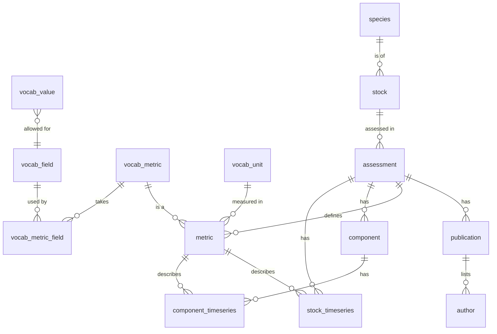

# FSAR database sketch

A relational layout for the FSAR assessment format. It has two groups of
tables:

- **Lookup tables** load straight from `vocab/*.csv` and are shared by all
  assessments.
- **Assessment tables** are what `as_tables()` produces for each assessment
  folder, with foreign keys into the lookup tables.

Keys are marked **PK**, and foreign keys **FK → table.column**.

## Lookup tables (from `vocab/`)

### `vocab_metric` (`metrics.csv`)

| Column | Type | Notes |
|---|---|---|
| `metric` | text | **PK**, e.g. `spawning_stock`, `limit_reference` |
| `sort_order` | int | row order in the CSV = canonical column order |
| `label_en`, `label_fr` | text | display labels (LRP, F, TAC, ...) |
| `panel` | text | `catch`, `stock`, `fishing_pressure`, `recruitment` |
| `role` | text | `series` or `reference` |
| `level` | text | `stock`, `component`, `both` |
| `dimensions` | text | allowed unit dimensions, `mass\|count`; could be split into a `vocab_metric_dimension` table |
| `description` | text | |

### `vocab_unit` (`units.csv`)

| Column | Type | Notes |
|---|---|---|
| `unit` | text | **PK**, e.g. `t`, `millions`, `1/yr`, `kg/trap` |
| `dimension` | text | `mass`, `count`, `rate`, `proportion`, `index` |
| `to_base` | real | multiplier to the base unit for that dimension |
| `label_en`, `label_fr` | text | |
| `description` | text | |

### `vocab_field` (`fields.csv`)

| Column | Type | Notes |
|---|---|---|
| `field` | text | **PK**, e.g. `units`, `basis`, `min_age` |
| `type` | text | `string`, `number`, `integer`, `years`, `metric` |
| `values_from` | text | lookup table the value must come from, if any |
| `description` | text | |

### `vocab_metric_field` (`metric_fields.csv`)

| Column | Type | Notes |
|---|---|---|
| `metric` | text | **PK**, FK → `vocab_metric.metric` |
| `field` | text | **PK**, FK → `vocab_field.field` |
| `required` | text | `yes`, `no`, `if` |
| `condition` | text | condition when `required = if` (validator logic; not enforced by the DB) |

### `vocab_value` (`values.csv`)

All small controlled lists in one table.

| Column | Type | Notes |
|---|---|---|
| `field` | text | **PK**, e.g. `basis`, `method.type`, `stock.region`, `publications.series` |
| `value` | text | **PK**, e.g. `b_msy`, `age_structured`, `maritimes`, `sar` |
| `label_en`, `label_fr` | text | |
| `description` | text | |
| `panel` | text | for `basis`: which panel's references it applies to (`stock` / `fishing_pressure`) |

A DB check on a column such as `assessment.region` would be a composite FK
`('stock.region', region) → vocab_value(field, value)`. Simpler alternatives
are a generated column holding the field name, or splitting into one small
table per list.

## Assessment tables (from `as_tables()`)

### `assessment`

From the YAML top level, `entered_by:`, `stock:`, `method:`, `meeting:`, and `interval:`.

| Column | Type | Notes |
|---|---|---|
| `assessment` | text | **PK**, formed from stock name + year, e.g. `example-stock-2024` |
| `year_assessed` | int | |
| `assessment_type` | text | FK → `vocab_value` (`assessment_type`): `full`, `update` |
| `stock_name_en`, `stock_name_fr` | text | until there is a `stock` table (below) |
| `species` | text | scientific name; until there is a `species` table |
| `species_en`, `species_fr` | text | common names |
| `aphia_id` | int | WoRMS AphiaID |
| `area_en`, `area_fr` | text | stock area, e.g. NAFO 4RST |
| `region` | text | FK → `vocab_value` (`stock.region`) |
| `management` | text | FK → `vocab_value` (`stock.management`) |
| `fish_stock_provisions` | bool | under the Fish Stocks provisions |
| `in_sustainability_survey` | bool | |
| `ram_legacy_id` | text | |
| `method_type` | text | FK → `vocab_value` (`method.type`) |
| `method_notes` | text | describes the method when `method_type` is `other` |
| `method_software` | text | FK → `vocab_value` (`method.software`) |
| `meeting_date` | date | peer-review meeting |
| `meeting_url` | text | CSAS meeting page |
| `csas_process` | text | dmapps CSAS process URL |
| `interval_level` | real | e.g. `0.95`; null if no bounds |
| `interval_type` | text | FK → `vocab_value` (`interval.type`): `confidence`, `credible`, ... |
| `entered_by_name` | text | |
| `entered_by_email` | text | |
| `entered_date` | date | |

### `publication`

One per document in `publications:` (e.g. a SAR and its Research Document).

| Column | Type | Notes |
|---|---|---|
| `assessment` | text | **PK**, FK → `assessment` |
| `position` | int | **PK**, order in `publications:` |
| `series` | text | FK → `vocab_value` (`publications.series`): `sar`, ... |
| `number` | text | e.g. `2025/001` |
| `year` | int | |
| `url` | text | |
| `doi` | text | |
| `title_en`, `title_fr` | text | |

Unique on (`series`, `number`).

### `author`

| Column | Type | Notes |
|---|---|---|
| `assessment` | text | **PK**, FK → `publication` |
| `publication` | int | **PK**, FK → `publication.position` |
| `position` | int | **PK**, author order |
| `given` | text | |
| `family` | text | |
| `orcid` | text | |

### `metric`

One row per metric used in the assessment (`metrics:`). Covers both stock and
component columns, so units and fields are shared across levels.

| Column | Type | Notes |
|---|---|---|
| `assessment` | text | **PK**, FK → `assessment` |
| `metric` | text | **PK**, FK → `vocab_metric` |
| `units` | text | FK → `vocab_unit`; dimension must be in `vocab_metric.dimensions` |
| `applies_to` | text | FK → (`assessment`, `metric`) in this table; filled in when inferred |
| `basis` | text | FK → `vocab_value` (`basis`) |
| `multiplier` | real | |
| `period_start`, `period_end` | int | from `period: [first, last]` |
| `percentile` | real | |
| `spr` | real | |
| `type` | text | FK → `vocab_value` (`type`); `fishing_pressure` in 1/yr only |
| `min_age`, `max_age` | int | null `max_age` = plus group |
| `age` | int | recruitment age |
| `survey` | text | for `index` |
| `notes` | text | free text, never parsed |

This is a wide table: one column per `vocab_field`. If fields are added often,
an alternative is a long `metric_field (assessment, metric, field, value)`
table, at the cost of typed columns.

### `stock_timeseries`

`stock_timeseries.csv` reshaped long.

| Column | Type | Notes |
|---|---|---|
| `assessment` | text | **PK**, FK → `assessment` |
| `year` | int | **PK** |
| `metric` | text | **PK**, FK → `metric (assessment, metric)`; a ratio's numerator |
| `relative_to` | text | **PK**; null for absolute values; for a ratio, `b_msy`, `f_msy`, or a reference point (FK → `metric (assessment, metric)`) |
| `value` | real | |
| `lower`, `upper` | real | both or neither; `lower <= value <= upper` |

`vocab_metric.level` must be `stock` or `both`, for both `metric` and
`relative_to`. A PK column can't be null in most databases, so either key on
a unique index over `coalesce(relative_to, '')`, or store `''` for absolute
values. That the reference point applies to the series is checked by the
validator, not the DB.

Absolute and relative values of the same series sit side by side:

| year | metric | relative_to | value | lower | upper |
|---|---|---|---|---|---|
| 2022 | `spawning_stock` | | 2755 | 2342 | 3169 |
| 2022 | `spawning_stock` | `limit_reference` | 2.296 | 1.722 | 2.985 |
| 2022 | `fishing_pressure` | `f_msy` | 0.532 | 0.346 | 0.798 |

### `component`

| Column | Type | Notes |
|---|---|---|
| `assessment` | text | **PK**, FK → `assessment` |
| `component` | text | **PK**, e.g. `north` |
| `name_en`, `name_fr` | text | |

### `component_timeseries`

`component_timeseries.csv` reshaped long.

| Column | Type | Notes |
|---|---|---|
| `assessment` | text | **PK**, FK → `component` |
| `component` | text | **PK**, FK → `component` |
| `year` | int | **PK** |
| `metric` | text | **PK**, FK → `metric (assessment, metric)` |
| `relative_to` | text | **PK**, as in `stock_timeseries` |
| `value` | real | |
| `lower`, `upper` | real | |

`vocab_metric.level` must be `component` or `both`, for both `metric` and
`relative_to`.

## Likely additions (from the README's open questions)

### `species`

| Column | Type | Notes |
|---|---|---|
| `species` | text | **PK**, scientific name |
| `common_name_en`, `common_name_fr` | text | |
| `itis_tsn` / `worms_aphia_id` | int | optional external IDs |

### `stock`

Built from the `DFO-stocks/` lists, so the same stock links across assessment
years.

| Column | Type | Notes |
|---|---|---|
| `stock` | text | **PK** |
| `name_en`, `name_fr` | text | |
| `species` | text | FK → `species` |
| `region` | text | FK → `vocab_value` (`stock.region`) |
| `ram_stockid` | text | optional link to RAM Legacy |

`assessment` would then have `stock` (FK) in place of `stock_name_*`,
`species`, and `region`.

### Other possible changes

- **Reference point status:** add `status` (`proposed`, `adopted`) to
  `metric`.
- **Per-component overrides:** a `component_metric (assessment, component,
  metric, ...)` table with the same fields as `metric`, used only where a
  component differs (e.g. a percentile-based salmon benchmark).
- **Supersedes:** derived by the database, not entered. Once `assessment`
  has a `stock` FK, the assessment a new one replaces is the previous
  `year_assessed` for the same stock, e.g. a `supersedes` column filled on
  load or a view using `lag(assessment) over (partition by stock order by
  year_assessed)`.
- **Corrections:** re-entering an assessment (same stock and year) replaces
  it; `entered_date` records when.
